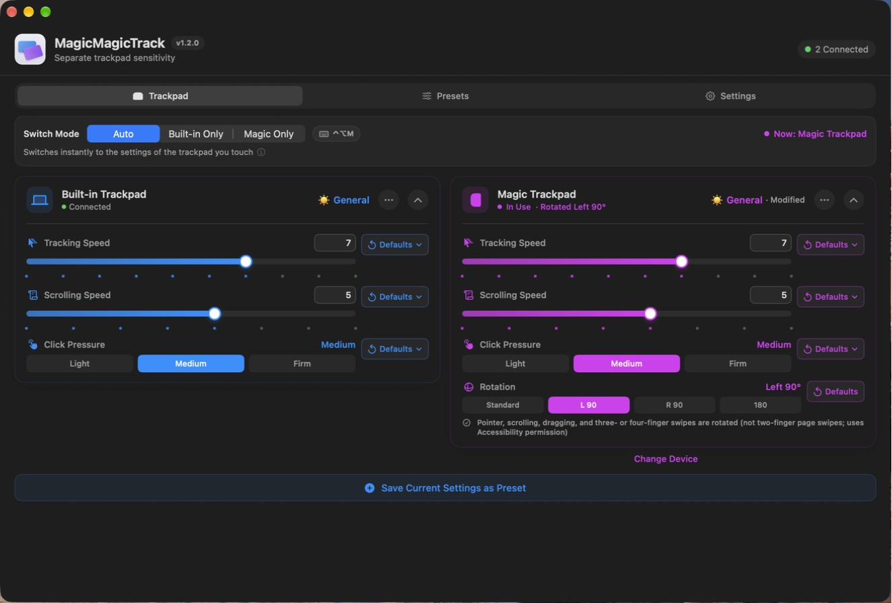
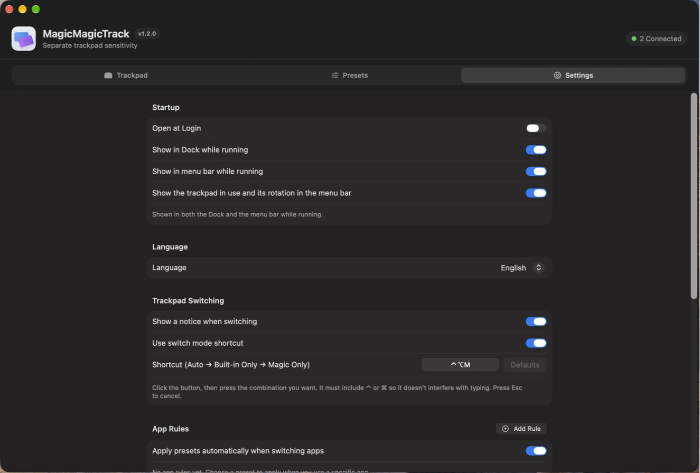

# MagicMagicTrack

[한국어](README.md) · **English**

A macOS app that gives your MacBook's built-in trackpad and your Magic Trackpad **separate** tracking speed, scrolling speed, and click pressure, and lets you use the Magic Trackpad **rotated**.

macOS applies one set of settings to every trackpad. MagicMagicTrack recognizes the trackpad you touch and switches to its settings instantly.



## Features

- **Per-trackpad settings**: separate tracking speed, scrolling speed, and click pressure for the built-in and Magic Trackpad (same steps as System Settings)
- **Automatic switching**: switches to the settings of the trackpad you touch, or lock to Built-in Only / Magic Only
- **Switch shortcut**: `⌃⌥M` by default cycles Auto → Built-in Only → Magic Only. Can be changed or turned off
- **Magic Trackpad rotation**
  - 180°: pointer, scrolling, and gestures are all flipped (no permission needed)
  - Left / Right 90°: pointer, click, drag, scrolling, and three- or four-finger swipes (switching desktops, Mission Control) are rotated (needs Accessibility permission)
- **Reset to defaults**: per setting, choose "My Default" or "Mac Default" (Tracking 4 · Scrolling 4 · Click Medium)
- **Presets**: edit, duplicate, delete; shows "Modified" when the current values differ from the preset
- **App rules**: apply a preset automatically when you use a specific app
- **Menu bar**: shows the trackpad in use and its rotation as an icon and text (e.g. `Magic L 90°`)
- **한국어 / English**: choose the language in the Settings tab (Korean by default)



**System Settings values are never changed.** The app only overrides the running values while it is open; quitting restores the System Settings values.

## Requirements

- macOS 14 or later (**tested on macOS 27**; earlier versions have not been verified yet)
- Magic Trackpad features need a Magic Trackpad connected over Bluetooth or USB

## Install

1. Download `MagicMagicTrack-<version>.dmg` from [Releases](https://github.com/taehee33/magictrack202603/releases/latest) and move `MagicMagicTrack.app` to the Applications folder.
2. If an "unidentified developer" warning appears on first launch, go to **System Settings › Privacy & Security** and click **Open Anyway**.
   The app is currently distributed without Apple Developer ID signing and notarization, so the warning appears once.
3. If you have the old `MagicTrack.app`, delete it. Settings, presets, and app rules carry over.

Details: [Installation Guide](docs/install/install-guide-en.md)

## Permissions

| Feature | Permission |
|---|---|
| Speed, scrolling, click pressure, automatic switching, app rules, 180° rotation | None |
| Left / Right 90° rotation | Accessibility |

If you turn on 90° rotation without the permission, the Magic Trackpad card shows a notice. Click **Open Permissions** and allow it; rotation starts right away.

## Known limitations

- **Uses private macOS features** (MultitouchSupport, System Settings internals, private event fields, SkyLight). A macOS update may break some features. If automatic switching is unavailable, the app falls back to a fixed mode.
- At 90°, **two-finger page swipes (back / forward) are not rotated.** Direction-independent gestures such as pinch work as usual.
- While rotated 90°, the app moves the cursor itself when you use the Magic Trackpad.
- Because it needs private features and runs outside the sandbox, it **cannot be published on the Mac App Store.**

## Building from source

```bash
xcodebuild -project MagicTrack.xcodeproj -scheme MagicTrack -configuration Debug \
  -derivedDataPath /tmp/MagicTrackDerivedData build
open /tmp/MagicTrackDerivedData/Build/Products/Debug/MagicMagicTrack.app
```

### Code signing

By default the app is ad-hoc signed ("Sign to Run Locally"), so it builds as is. However, an ad-hoc signature changes with every build, so **you have to allow Accessibility again after each build**. Sign with your own certificate to keep the permission across builds.

```bash
cp Config/Signing.local.xcconfig.example Config/Signing.local.xcconfig
# Set DEVELOPMENT_TEAM in Signing.local.xcconfig to your team ID (not committed to git)
```

### Tests and tools

| Command | What it does |
|---|---|
| `zsh Tests/run_tests.sh` | Unit tests for device detection, switching rules, speed steps, and defaults |
| `zsh tools/generate_app_icon.sh` | Regenerates the app icon (after editing `tools/icon/make_icon_composer.py`) |
| `python3 -I tools/localization/update_catalog.py` | Extracts UI strings and updates the English catalog (translations in `tools/localization/en.py`) |
| `zsh tools/package_release.sh` / `zsh tools/package_dmg.sh` | Release zip / dmg (`dist/`) |

The version lives in one place: the Xcode build settings `MARKETING_VERSION` / `CURRENT_PROJECT_VERSION`.

## Documents

- Release notes (Korean): [v1.2.0](docs/release/release-notes-v1.2.0.md) · [v1.1.1](docs/release/release-notes-v1.1.1.md) · [v1.1.0](docs/release/release-notes-v1.1.0.md)
- [Installation Guide (English)](docs/install/install-guide-en.md) · [설치 가이드 (한국어)](docs/install/install-guide-ko.md)
- Publishing (Korean): [GitHub Releases](docs/publish/github-releases-without-developer-id.md) · [Release checklist](docs/publish/public-release-checklist.md) · [Notarization](tools/notarization_setup.md)
