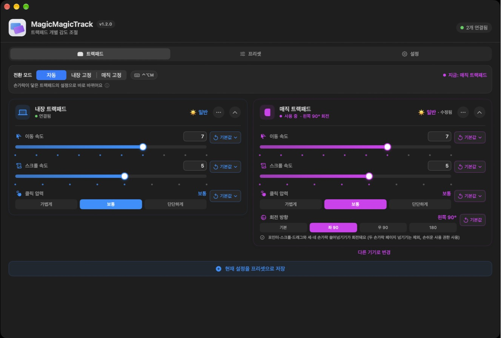
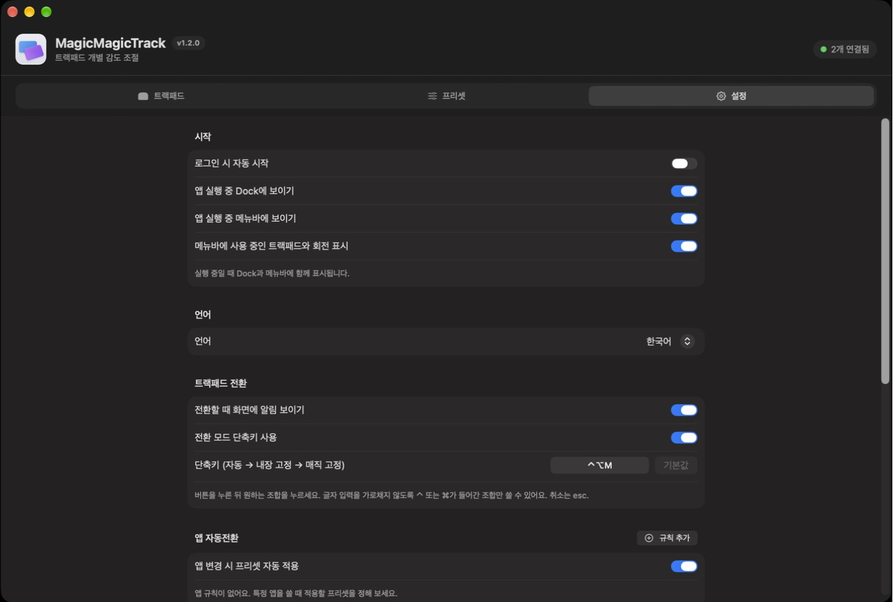

# MagicMagicTrack

**한국어** · [English](README.en.md)

맥북 내장 트랙패드와 매직 트랙패드의 **이동 속도·스크롤·클릭 압력을 따로** 정하고, 매직 트랙패드를 **돌려 놓고** 쓸 수 있게 해 주는 macOS 앱입니다.

macOS는 모든 트랙패드에 같은 설정을 씁니다. MagicMagicTrack은 손가락이 닿은 트랙패드를 알아보고 그 트랙패드의 설정으로 바로 바꿔 줍니다.



## 주요 기능

- **트랙패드별 설정**: 내장 / 매직 트랙패드의 이동 속도·스크롤 속도·클릭 압력을 따로 저장 (시스템 설정과 같은 칸)
- **자동 전환**: 손가락이 닿은 트랙패드의 설정으로 바로 전환. 내장 고정 / 매직 고정도 가능
- **전환 단축키**: 기본 `⌃⌥M`으로 자동 → 내장 고정 → 매직 고정 순환. 바꾸거나 끌 수 있음
- **매직 트랙패드 회전**
  - 180°: 포인터·스크롤·제스처 모두 뒤집힘 (권한 필요 없음)
  - 왼쪽·오른쪽 90°: 포인터·클릭·드래그·스크롤, 두 손가락 페이지 넘기기(뒤로·앞으로), 세·네 손가락 쓸어넘기기(데스크톱 전환, Mission Control) 회전 (손쉬운 사용 권한 필요)
- **기본값 되돌리기**: 항목마다 '내 기본값'과 'Mac 기본값'(이동 4칸 · 스크롤 4칸 · 클릭 보통)
- **프리셋**: 편집·복제·삭제, 지금 값이 프리셋과 다르면 '수정됨' 표시
- **앱 규칙**: 특정 앱을 쓸 때 정한 프리셋을 자동 적용
- **메뉴바**: 지금 쓰는 트랙패드와 회전을 아이콘과 글자로 표시 (예: `매직 좌 90°`)
- **한국어 / English**: 설정 탭에서 언어 선택 (기본 한국어)



**시스템 설정 값은 바꾸지 않습니다.** 앱이 켜져 있는 동안 실행 중인 값만 덮어쓰고, 앱을 끄면 시스템 설정 값으로 돌아갑니다.

## 요구 사항

- macOS 14 이상 (**macOS 27에서 테스트**. 그 이전 버전은 아직 확인하지 못했습니다)
- 매직 트랙패드 기능은 블루투스 또는 USB로 연결한 매직 트랙패드 필요

## 설치

1. [Releases](https://github.com/taehee33/magictrack202603/releases/latest)에서 `MagicMagicTrack-버전.dmg`를 받아 `MagicMagicTrack.app`을 `응용 프로그램` 폴더로 옮깁니다.
2. 처음 열 때 "확인되지 않은 개발자" 경고가 나오면 **시스템 설정 › 개인정보 보호 및 보안**에서 **그래도 열기**를 누릅니다.
   지금은 Apple Developer ID 서명·공증 없이 배포해서 처음 한 번 경고가 나옵니다.
3. 예전 `MagicTrack.app`이 있으면 지워 주세요. 설정·프리셋·앱 규칙은 그대로 이어집니다.

자세한 내용: [설치 가이드](docs/install/install-guide-ko.md)

## 권한

| 기능 | 필요한 권한 |
|---|---|
| 속도·스크롤·클릭 압력, 자동 전환, 앱 규칙, 180° 회전 | 없음 |
| 왼쪽·오른쪽 90° 회전 | 손쉬운 사용 |

90° 회전을 켰는데 권한이 없으면 매직 트랙패드 카드에 안내가 나옵니다. **권한 열기**를 눌러 허용하면 바로 동작합니다.

## 알려진 한계

- **비공개 macOS 기능을 씁니다** (MultitouchSupport, 시스템 설정 내부 기능, 이벤트 비공개 필드, SkyLight). macOS 업데이트로 바뀌면 일부 기능이 멈출 수 있습니다. 자동 전환을 쓸 수 없으면 고정 모드로 동작합니다.
- 90° 회전 중에는 매직 트랙패드를 쓰는 동안 커서를 앱이 직접 움직입니다.
- 비공개 기능과 샌드박스 밖 동작이 필요해서 **Mac App Store에는 낼 수 없습니다.**

## 직접 빌드하기

```bash
xcodebuild -project MagicTrack.xcodeproj -scheme MagicTrack -configuration Debug \
  -derivedDataPath /tmp/MagicTrackDerivedData build
open /tmp/MagicTrackDerivedData/Build/Products/Debug/MagicMagicTrack.app
```

### 코드 서명

기본값은 이 맥에서만 실행되는 임시 서명(ad-hoc)이라 그대로 빌드됩니다. 다만 임시 서명은 빌드할 때마다 바뀌어서 **손쉬운 사용 권한을 매번 다시 허용**해야 합니다. 같은 인증서로 계속 서명하면 다시 빌드해도 권한이 유지됩니다.

```bash
cp Config/Signing.local.xcconfig.example Config/Signing.local.xcconfig   # git에 올라가지 않음
```

- **자체 서명 인증서 (추천, 무료)**: 키체인 접근 › 인증서 지원 › 인증서 생성에서 이름 `MagicMagicTrack`, 신원 유형 '자체 서명 루트', 인증서 유형 '코드 서명'으로 만듭니다. 서명에 이메일이나 실명이 들어가지 않습니다. 배포본은 이 방식으로 서명합니다.
- **Apple Development 인증서**: 예시 파일의 2번을 씁니다. 서명에 Apple ID 이름(또는 이메일)이 들어갑니다.

### 테스트·도구

| 명령 | 하는 일 |
|---|---|
| `zsh Tests/run_tests.sh` | 장치 판별·전환 규칙·속도 칸·기본값 단위 테스트 |
| `zsh tools/generate_app_icon.sh` | 앱 아이콘 다시 만들기 (`tools/icon/make_icon_composer.py`를 고친 뒤) |
| `python3 -I tools/localization/update_catalog.py` | 화면 문구를 뽑아 영어 번역 카탈로그 갱신 (번역은 `tools/localization/en.py`) |
| `zsh tools/package_release.sh` / `zsh tools/package_dmg.sh` | 배포용 zip / dmg (`dist/`) |

버전은 Xcode 빌드 설정 `MARKETING_VERSION` / `CURRENT_PROJECT_VERSION` 한 곳에서 관리합니다.

## 문서

- [릴리즈 노트 v1.3.0](docs/release/release-notes-v1.3.0.md) · [v1.2.0](docs/release/release-notes-v1.2.0.md) · [v1.1.1](docs/release/release-notes-v1.1.1.md) · [v1.1.0](docs/release/release-notes-v1.1.0.md)
- [설치 가이드 (한국어)](docs/install/install-guide-ko.md) · [Installation Guide (English)](docs/install/install-guide-en.md)
- [GitHub Releases로 배포하기](docs/publish/github-releases-without-developer-id.md) · [공개 배포 체크리스트](docs/publish/public-release-checklist.md) · [공증 준비](tools/notarization_setup.md)
